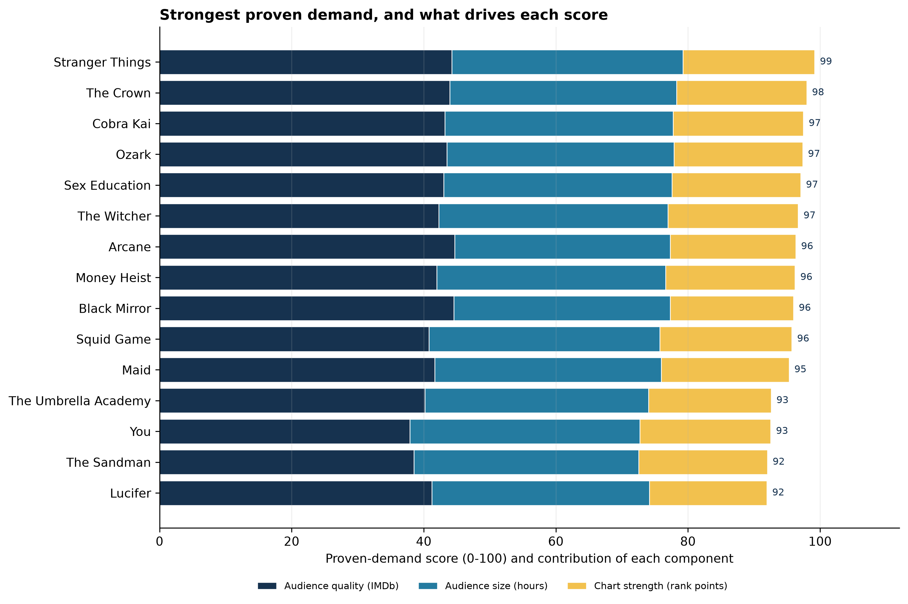
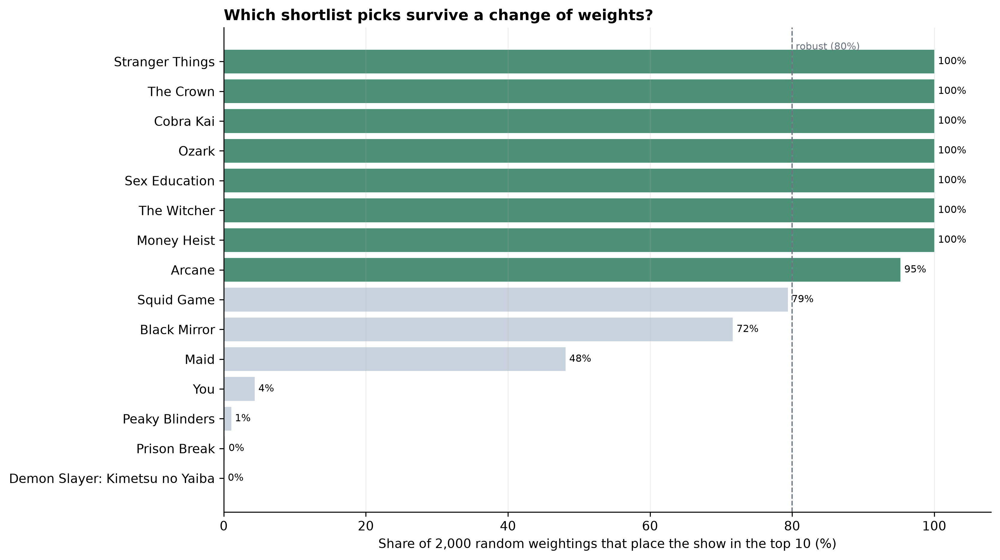
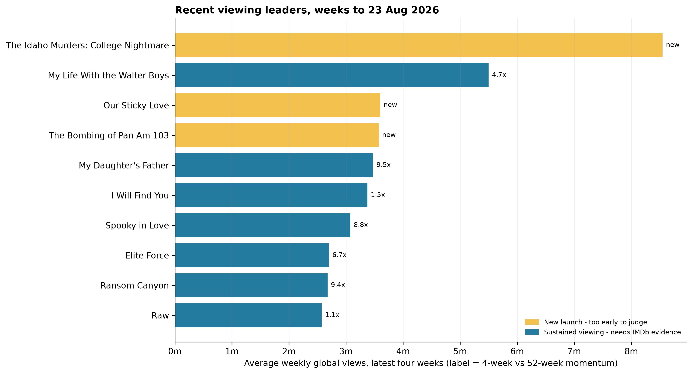

# Netflix Content Demand Analysis

## Project overview

I built this project while learning Python for data analysis. I wanted to answer a question a content or commercial team could actually face:

> **Which TV shows have strong, durable audience demand, and which recent hits might only be short-term spikes?**

The answer feeds the next decision. For a show Netflix owns, that decision is renewal, a spin-off or marketing investment. For a licensed show, it is licence renewal or acquisition research.

I used pandas to load, check, clean, match and score three datasets, and Matplotlib to present the results. The output is a **research shortlist, not a recommendation to buy anything**. The data contains no rights, licence costs, UK audiences or flag for whether a show is a Netflix original. I left those fields blank instead of inventing them.

## What I found

- **Eight shows have demand that holds up under any reasonable weighting:** Stranger Things, The Crown, Cobra Kai, Ozark, Sex Education, The Witcher, Arcane and Money Heist. Each stays in the top 10 in at least 95% of 2,000 random weightings of the score.
- **Squid Game has the second-largest audience (5.05bn hours, 42 Top 10 weeks) but is not a robust pick.** Its 8.0 IMDb rating is lower than its peers', so its place in the top 10 depends on how much weight quality gets (79% of weightings).
- **The IMDb file is a 2022 snapshot, and that is the biggest weakness in the data.** 76% of the shows that reached the Top 10 have no rating, including *Wednesday* (2.9bn hours) and *The Night Agent*. In 109 of those cases, a good rating would put the show among the leaders. A single bulk download from IMDb would add more value than any further modelling.
- **Most of the current momentum leaders are new launches.** They are labelled "new" and kept off the long-term shortlist until they show staying power.
- **No show can pass the commercial gate yet.** Rights, ownership and cost are all unconfirmed.

## Methodology review: what changed in version 2

I reviewed the first version as a senior analyst would and found problems that changed the answer. I'm keeping this section in the README because finding and fixing these mattered more than the original charts.

| # | Problem in version 1 | Effect | Fix |
|---|---|---|---|
| 1 | Missing IMDb data was filled with **zero** (`fillna(0)`) | 73% of shows lost up to 55 of 100 points. *Wednesday*, with the fourth-highest viewing hours, ranked **246th** | A missing rating gets a neutral (median) quality score, which is what a Bayesian rating does with zero votes. These shows are labelled "Viewing only" and kept off the final shortlist |
| 2 | IMDb was matched on **title only**, keeping the most-voted record | *Avatar: The Last Airbender* (2024 live action) was scored with the 2005 cartoon's 9.3 and ranked **2nd**. *The Gentlemen* series got the 2019 film's rating | Films are removed from the matching pool, records are matched by debut season and year, and 19 reviewed decisions are recorded in [`data/title_match_overrides.csv`](data/title_match_overrides.csv) |
| 3 | Score components were on **different scales** (raw rating/10 next to percentiles), and `log1p` was applied before ranking | The rating hardly separated shows, and the log transform had no effect | Every component is now a percentile. Rating and votes are combined into one Bayesian weighted rating |
| 4 | Weights were chosen by hand and never tested | Ranks to one decimal place looked more certain than they were | 2,000 Dirichlet weight draws. A show counts as **robust** if it is in the top 10 under at least 80% of them |
| 5 | New launches got huge momentum ratios (for example "13.0x") | Launch-week hype looked like growth | Shows in their first 4 weeks are labelled **new** |
| 6 | Invented viewer numbers (`750k + 6.25m × score`) and £2.50 per viewer fed an ROI section | Made-up figures appeared in a chart. They were also just the demand score restated, so they added nothing | Removed. A commercial gate lists the inputs it needs and stays empty until those inputs are real |

## Business questions

### 1. Which shows have the strongest proven demand?

Each component is a percentile across all 1,250 shows that reached the global Top 10 between July 2021 and August 2026:

| Component | Measure | Weight |
|---|---|---:|
| Audience quality | Bayesian weighted IMDb rating, `v/(v+m)·R + m/(v+m)·C` with m = 25,000 votes | 45% |
| Audience size | Total Top 10 viewing hours. This is the only volume measure that covers the full period, because `weekly_views` starts in mid-2023 | 35% |
| Chart strength | Rank points (11 − weekly rank, summed). This rewards both staying power and high positions, and doesn't depend on runtime | 20% |

| Rank | Show | IMDb | Votes | Top 10 hours | Weeks | Score | In top 10 under |
|---:|---|---:|---:|---:|---:|---:|---:|
| 1 | Stranger Things | 8.7 | 1,149,902 | 5.84bn | 34 | 99.2 | 100% |
| 2 | The Crown | 8.7 | 199,898 | 0.68bn | 18 | 98.0 | 100% |
| 3 | Cobra Kai | 8.5 | 177,031 | 0.96bn | 18 | 97.5 | 100% |
| 4 | Ozark | 8.5 | 309,552 | 0.75bn | 13 | 97.4 | 100% |
| 5 | Sex Education | 8.4 | 273,671 | 0.90bn | 12 | 97.1 | 100% |
| 6 | The Witcher | 8.2 | 481,841 | 1.25bn | 18 | 96.7 | 100% |
| 7 | Arcane | 9.0 | 196,697 | 0.32bn | 12 | 96.3 | 95% |
| 8 | Money Heist | 8.2 | 469,640 | 1.19bn | 16 | 96.2 | 100% |
| 9 | Black Mirror | 8.8 | 535,785 | 0.33bn | 9 | 96.0 | 72% |
| 10 | Squid Game | 8.0 | 435,164 | 5.05bn | 42 | 95.7 | 79% |



### 2. Does the ranking survive a change of weights?

The weights are my judgement, so I tested them. I drew 2,000 weightings from a Dirichlet distribution centred on 45/35/20 and re-ranked every show each time. The top eight hold up. Black Mirror, Squid Game and Maid move in and out of the top 10 depending on the weighting, so they go on the watchlist.



### 3. Is interest growing, and is it reliable?

`momentum = average weekly views over the last 4 weeks / average over the last 52 weeks`

Both averages use a complete 52-week calendar, so a week outside the Top 10 counts as zero observed views. Those zeros are a lower bound: they mean "not in the Top 10", not "not watched".

Each show gets one of these labels:

- **Sustained, well-rated:** at least 4 Top 10 weeks, at least 25,000 IMDb votes and a rating of 7.0 or higher.
- **Needs IMDb evidence:** sustained viewing, but no rating.
- **Possible short-term spike:** a sharp rise with 2 or fewer Top 10 weeks.
- **New launch:** in its first 4 weeks, too early to judge.



### 4 to 7. Is a show obtainable, and would it pay back?

This data can't answer either question. The notebook builds the gate the answers will go through:

- **Rights gate:** rights are confirmed available.
- **Value gate:** a calibrated cautious-case UK audience × an agreed value per viewer is at least the licence cost.

Every input starts empty, so every show is on hold. A **value-of-information** check marks the unrated shows whose IMDb rating would actually change the shortlist, so research effort goes where it matters most.

### 8. What information is still missing?

| Missing information | Preferred source | Why it matters |
|---|---|---|
| Content ownership (original or licensed) | Netflix press site, distributor records | Decides whether the next step is renewal or licence acquisition |
| Current IMDb ratings (the snapshot ends about 2022) | IMDb non-commercial datasets (`title.ratings`) | 76% of shows have no quality evidence |
| Original UK audience | BARB or broadcaster reports | Confirms UK demand |
| Google Trends history | Google Trends export (UK) | Measures current UK interest |
| Netflix UK title audience | Internal analytics | Calibrates any viewer estimate |
| Licence cost, rights, platform, production status | Distributor, legal, trade press | Needed for the commercial gate |

## Data coverage: check it before joining

| File | Covers | Consequence |
|---|---|---|
| `netflix_weekly_top10.csv` | July 2021 to August 2026, global, English and non-English TV lists | `weekly_views` only from mid-2023, so the score uses hours |
| `imdb_ratings.csv` | A snapshot from about 2022, with series, episodes **and films** mixed together | Shows launched after 2022 can't have a rating, and films must be filtered out before matching |
| `netflix_titles.csv` | Catalogue additions up to January 2021 | Ends before the Top 10 data starts, so it is context only and can't show current availability |

## Outputs

| File | Contents |
|---|---|
| `outputs/acquisition_decision_table.csv` | Every show with evidence, component scores, rank stability, momentum, gates and recommendation |
| `outputs/shortlist_research_template.csv` | Shortlist, watchlist and "collect rating" shows, with blank commercial fields to fill in |
| `outputs/title_match_review.csv` | Every IMDb match that was flagged, accepted or rejected, for audit |
| `outputs/data_gap_register.csv` | Missing inputs, where to get them and why they matter |

## Skills demonstrated

- **pandas:** typed CSV imports, coverage and quality checks, regex title keys, named `groupby` aggregations, a complete calendar built with `MultiIndex.from_product`, validated merges (`validate="one_to_one"`), percentile ranking, `np.select` rule labels, and vectorised NumPy sensitivity analysis.
- **Analytical judgement:** spotting a period mismatch between datasets, telling missing data apart from zeros, Bayesian shrinkage, robustness testing, value-of-information thinking, and documented manual overrides.
- **Matplotlib:** stacked contribution bars, threshold reference lines, colour-coded categories with legends, and charts exported at 300 dpi.

## Repository structure

```text
python-for-data-analysis/
├── data/
│   ├── imdb_ratings.csv
│   ├── netflix_titles.csv
│   ├── netflix_weekly_top10.csv
│   ├── title_match_overrides.csv   # reviewed IMDb match decisions with reasons
│   └── README.md
├── images/
│   ├── proven_demand.png
│   ├── rank_stability.png
│   └── current_momentum.png
├── outputs/
│   ├── acquisition_decision_table.csv
│   ├── data_gap_register.csv
│   ├── shortlist_research_template.csv
│   └── title_match_review.csv
├── netflix_content_demand_analysis.ipynb
├── requirements.txt
└── README.md
```

## How to run

```bash
pip install -r requirements.txt
jupyter notebook netflix_content_demand_analysis.ipynb   # then Restart Kernel and Run All
```

The notebook reads the included CSVs through relative paths. The random weightings use a fixed seed, so every run gives the same results.

## Limitations

- The Top 10 is **global**, not UK, and only shows a title once it reaches the Top 10, so every viewing figure is a lower bound.
- Viewing hours favour shows with long seasons and many seasons in the period. Rank points partly balance this.
- IMDb matching is rule-based plus manual review of flagged cases. Matches that weren't flagged could still be wrong.
- The 45/35/20 weights are a judgement. The stability test shows which conclusions depend on them.
